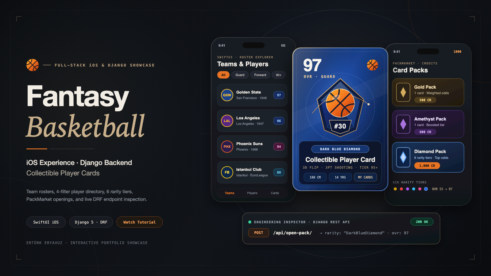

# Fantasy Basketball — Interactive Portfolio Showcase

[](https://erturkeryavuz.github.io/fantasy-basketball-demo/)

**Live Interactive Showcase (GitHub Pages):** [https://erturkeryavuz.github.io/fantasy-basketball-demo/](https://erturkeryavuz.github.io/fantasy-basketball-demo/)

An interactive, zero-dependency, phone-framed static portfolio showcase presenting the **Fantasy Basketball** full-stack graduation project (Maltepe University, B.Sc. in Computer Engineering) by **Ertürk Eryavuz**.

> **Source Availability & Boundary Notice**
> The original full-stack engineering repository (Django 5 + Django REST Framework backend and native SwiftUI iOS client) is **private**. This public repository contains **only** the sanitized static web showcase (`docs/`), third-party media attribution notices, and offline verification checks. It runs entirely in the browser over static demonstration state — with **no live backend, no database connection, no authentication server, and no external network requests**.

## What This Showcase Demonstrates

- **SwiftUI Mobile Flows (Simulated):** Token-authenticated registration/login screens, club/team rosters, a 4-filter player directory, six rarity tiers (`Gold` through `DarkBlueDiamond`), credit-based `PackMarket` pack opening (`POST /api/open-pack/`), and a personal `My Cards` inventory.
- **Live Engineering Inspector:** Side-by-side view of matching Django REST Framework endpoints, HTTP status codes, authentication/permission boundaries, and serializer payload shapes.
- **Explicit Scope Distinction:** Backend-only league management endpoints (10-player leagues, round-robin schedules, match results, standings) are clearly documented as backend REST endpoints not yet wired into the SwiftUI mobile screens.

## Media Licensing & Attribution

All showcase media in `docs/assets/` are either original vector graphics authored for this repository (5 SVGs) or cropped/resized derivatives of openly licensed Wikimedia Commons photographs (9 JPEGs under `CC BY 2.0/4.0` and `CC BY-SA 2.0/4.0`). Repository cover and social preview assets in `media/` (including editable vector sources in `media/src/`) are 100% original artwork created for this showcase and contain no third-party photographs, athlete likenesses, or club/league trademarks.

- Full attribution table: [docs/THIRD-PARTY-NOTICES.md](docs/THIRD-PARTY-NOTICES.md)
- Live notices page: [https://erturkeryavuz.github.io/fantasy-basketball-demo/notices.html](https://erturkeryavuz.github.io/fantasy-basketball-demo/notices.html)

This showcase is an independent, unmonetized academic/portfolio demonstration and is not affiliated with, endorsed by, or sponsored by the NBA, Euroleague Basketball, any basketball club, or any athlete.

## Local Preview & Offline Verification

```bash
# Run deterministic offline safety, asset, and link checks
python3 tests/verify_demo.py

# Serve locally
python3 -m http.server 8080 --directory docs
# Open http://127.0.0.1:8080/
```
